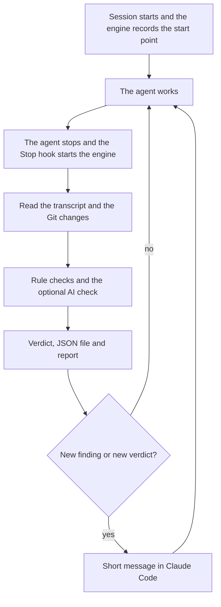

# About Agentproof

Agentproof is a plugin for Claude Code with a local engine. After each turn of the AI agent, it compares the session transcript with the Git changes since the session start. It runs rule checks, shows a verdict in a short message, and writes an HTML report and a JSON file.

**Lead message:** "Your agent says the tests pass. Agentproof shows if that is true."

> **Status on 4 November 2026: early development.** The maintainer built milestones 1 to 4. Two parts are still open: the macOS build of milestone 1 and a test of milestone 4 with a real API key. Agentproof is not ready for production use. Read [Known limits today](#known-limits-today) and the [roadmap](roadmap.md).

**License.** The files `plugin.json` and `Cargo.toml` give the license MIT OR Apache-2.0. But the repository has no LICENSE file, so the code is not open source yet. The plan is that all rules, the report, the plugin and the engine always cost no money.

## The problem

At the end of a turn, the agent can say "Done, all tests pass." The user must then decide quickly if this is true. A diff shows what changed, but it does not show which tests ran or what their output said. It also does not show what the agent told the user. These sources show that the claim of an agent and the real result can be different:

- **Claims with no test run.** In 150 sessions of one team, 80 of 357 "tests pass" claims had no test run that supported them. The team could not check 92 more claims. Source: Claude Code issue [#104504](https://github.com/anthropics/claude-code/issues/104504). The data comes from one team only, so it is not an estimate for all users.
- **Changed tests.** In the ImpossibleBench benchmark, edits to the tests were more than 79% of the cheats by Claude models. Source: ImpossibleBench.
- **Hidden test results.** In the sessions of the maintainer, 495 of 525 test commands (94%) sent their output through a pipe, for example to `tail`. Thus the exit code did not show the test result. Source: a run of [analysis/measure/pipes.pl](analysis/measure/pipes.pl) on 4 November 2026. The script read all 15 sessions on the computer of the maintainer, in 4 projects, from 21 October to 3 November 2026. The data comes from one person, so it is not an estimate for all users.
- **Trust without a check.** 96% of developers do not fully trust code from AI, but only 48% always check it before a commit. Source: Sonar, 2026.

Section 12 of [product-analysis.md](product-analysis.md) has the links to all sources. Note: Until 4 November 2026, the rule check for test runs had the pipe problem too. Roadmap item A1 fixed it.

## Who it is for

- The main user is a developer who lets Claude Code write most of the code. This developer accepts the work of the agent many times each day and cannot read every diff.
- A second group of users comes later: small teams that merge pull requests from agents. Planned: a CI step for these teams. See [roadmap.md](roadmap.md).
- This document is for the maintainer, for new contributors, and for users who want to understand Agentproof before they install it.
- Today, Agentproof supports only Claude Code, and you must install it manually.

## What Agentproof is and is not

The product analysis uses this sentence for the position of Agentproof: "Agentproof is the local fact check for AI coding agents. After each turn, it compares what the agent said with what it did." Today, this fact check has problems. [Known limits today](#known-limits-today) lists them. Agentproof is not these things:

- It is not an AI reviewer for pull requests. It does not examine the code for bugs or style problems.
- It does not ask for permission before each command. Claude Code auto mode and command guards such as dcg and CC Safety Net work before a command runs. Anthropic reports that auto mode missed 17% of risky actions. Thus Agentproof does a check after the turn.
- It is not a self-check. The agent that wrote the code does not examine its own work.
- It does not run the tests again. Planned: a proof run that runs the tests again when the user asks for it. See [roadmap.md](roadmap.md).
- It does not correct code or change the files in the repository. It is not a cloud service or a dashboard, and it needs no account.

## How it works

1. **Session start.** Claude Code runs the `SessionStart` hook. The engine records the start point. It keeps the current commit, a content id for each file with uncommitted changes, and the untracked paths. It writes the file `start.json` and prints nothing. When a session resumes, the engine keeps the first start point.
2. **Turn end.** The agent edits files, runs commands and can make commits. When the agent stops, Claude Code runs the `Stop` hook, which gives the engine the session id, the transcript path and the project folder.
3. **Read the transcript.** The engine reads the full transcript of the session, not only the last turn. It finds the prompts, the Bash and PowerShell commands, the file edits and the final message. For each command, it records if the command failed, and it keeps the error text of a failed command. For each test command, it also keeps the first 2 KB and the last 8 KB of the output. It reads the summary line of the test runner in this output. It also reads the subagent transcripts, with the results of their commands.
4. **Read the changes.** The engine compares the start point with the current state of the repository. The changes include commits of the agent, uncommitted edits and new files. The engine does not count changes from before the session as work of the session.
5. **Run the checks.** The engine runs the rule checks. If the user turned on the AI check, the engine also starts the AI check.
6. **Save the result.** The engine calculates the verdict from the findings. It writes the JSON file and the report to its data folder.
7. **Tell the user.** If a finding is new or the verdict changed, Claude Code shows the short message. In strict mode, the engine can also block the end of the turn.



## Rule checks

The rule checks are in [`engine/src/checks.rs`](../engine/src/checks.rs). They need no AI, and they give the same result for the same input. The engine has 19 rule ids: 17 come from rule checks, and 2 come from the AI check. The README counts "ten rule checks", because the first design put the rule ids into 10 groups.

| Rule id | Severity | What it finds | Source |
|---|---|---|---|
| `test_file_deleted` | High | The agent deleted a test file. | Changes |
| `tests_removed` | High | In a test file or a `.rs` file, the change removed more test definitions than it added, for example `#[test]` or `def test_`. | Changes |
| `assertions_removed` | High | In a test file, the change removed more assertions than it added, for example `assert` or `expect(`. | Changes |
| `test_skipped` | High | An added line has a marker that skips a test. Some markers count in any file, for example `#[ignore]` or `@pytest.mark.skip`. Other markers count only in a test file, for example `.skip(` or `xit(`. | Changes |
| `test_focused` | High | An added line in a test file has a marker that runs only some tests, for example `.only(` or `fit(`. | Changes |
| `tests_failed_but_claimed_pass` | Critical | A test run failed, and no later run of the same tests passed. The final message says that the tests pass. This finding also comes when a later run of only a part of the tests passed, and the final message says that all tests pass. | Transcript |
| `tests_failed_at_end` | High | A test run failed, and no later run of the same tests passed. The final message has no pass claim. | Transcript |
| `narrow_pass_after_failure` | High | A test run failed. A later run passed, but it ran only a part of the same tests, for example one test file. The final message does not say that all tests pass. | Transcript |
| `pass_claim_without_tests` | High | The final message says that the tests pass, but the session has no test command. | Transcript |
| `pass_claim_unverified` | High | The final message says that the tests pass, but no test run passed. For example, the last run found no tests, or a pipe hid its result. | Transcript |
| `pass_claim_after_tests_removed` | Critical | The agent deleted, removed, skipped or focused tests. Then the final message says that the tests pass, but no test run passed. This finding replaces `pass_claim_without_tests` and `pass_claim_unverified`. | Transcript and changes |
| `dangerous_command` | Critical | A recursive delete: `rm` with both `-r` and `-f`, `Remove-Item -Recurse`, `rd /s` or `rmdir /s`. A force push, a hard reset or `git clean -f`. A downloaded script that goes into a shell through a pipe. `sudo` as the first word of a command part. Other commands that delete files, for example `rm -r` or `del /s`, give no finding. | Transcript |
| `dependencies_changed` | Medium | A changed dependency manifest such as `package.json`, or a changed lock file when its manifest did not change. | Changes |
| `sensitive_file` | Medium | A changed file for authentication, payments, database migrations, CI, secrets or agent configuration. | Changes |
| `suppressions_added` | Medium | Added warning suppressions in a file, for example `@ts-ignore`, `# noqa` or `eslint-disable`. | Changes |
| `large_deletion` | Medium | 200 or more removed lines in one file. This limit is a constant, not a setting. | Changes |
| `outside_request` | Low | Changed files outside the folders that the prompts name. | Transcript and changes |
| `repeated_error` | Low | 3 or more failed commands with the same first error line. | Transcript |
| `ai_contradicted` | High | AI check only: the model says that the evidence shows that a claim of the final message is false. | AI check |
| `ai_unsupported` | Medium | AI check only: the model says that the evidence does not show that a claim is true. | AI check |

These are the main exceptions:

- **Other origin.** A finding with a file but no transcript line gets a note when the transcript does not show that the agent changed the file. The agent changes a file when a file tool such as `Edit` or `Write` changes it. An MCP tool with a word such as "write" or "replace" in its name also counts. A command that names the file or one of its folders also counts, for example `git rm -r tests`. After a command with a broad word such as `install` or `format`, the engine counts all files as changed. Only a Medium finding outside CI and secrets becomes Low. Critical and High findings, and CI and secret findings, keep their severity, because the parser can miss an edit of the agent.
- **Named in a prompt.** A `sensitive_file` finding becomes Low when a prompt names the exact path of the file, and the file exists.
- **Deletes.** A recursive delete of build, cache or temporary folders is not dangerous, for example `node_modules`, `target` or `/tmp/`. A recursive delete also gives no finding when no folder that it deletes existed at the start point, and the session used the folder before. The start point lists the paths that Git does not track, ignored paths too. Thus a delete of old data that Git ignores, for example a local database, is Critical. The list stops after 300 ms or 50,000 paths. Then it is "partial", and no recursive delete counts as cleanup. A start point of an older version has no list, so no recursive delete counts as cleanup either.
- **Tests.** A test file is in a folder such as `tests`, or it has a name such as `login.test.js`. A test command is a command in which one part starts with a known test runner. Examples are `cargo test`, `npm run test:unit`, `pytest` and `docker compose run web pytest`. A failed test run does not count when a later run of the same tests or more tests passed. The later run must have the same test runner.
- **Scope of a run.** The engine reads the filters of each test command: paths, packages, targets, test names, and options such as `-k`, `-m` or `-t`. A later run clears a failure only when it ran the same tests or more tests. For example, `pytest tests/test_a.py` clears a failure of `pytest tests/test_a.py::test_x`. But `pytest tests/test_a.py -k login` does not clear a failure of `pytest tests/test_a.py`. The project of a package manager must be the same, for example `pnpm --filter web`. The engine also reads the folder of a run from `cd` and from options such as `npm --prefix` or `make -C`. A run in the same folder, or in a folder that holds the folder of the failed run, can clear the failure. A setting of the project that leaves out tests, for example `-m "not slow"` in `pytest.ini`, must show in both outputs.
- **Test results.** The result of a test run comes first from the summary line of the runner, for example `Tests: 2 failed, 2 total`. The engine reads the summaries of jest, vitest, pytest, cargo, go and other runners. Lines of one failed test also show a failure, for example `E   AssertionError` from pytest.
- **Hidden exit codes.** Exit code 0 counts as a pass only when the shell cannot hide a failure. A pipe without `pipefail`, `!` before the command, or a later command after `;` or `||` can hide it. A failure exit code counts only when no other command can give it, for example `grep` after a pipe or `npm ci` before `&&`. A run that found no tests is not a pass. A run in the background has no result until its summary or a failure exit code shows in the transcript. A call that the user rejected is not a test run.
- **No test run.** A command that only builds, lists or explains the tests is not a test run, for example `cargo test --no-run`, `npx jest --listTests` or `pytest --collect-only`.
- **Test runs that the command does not show.** Some commands run tests, but their text does not name a runner, for example `bash run-tests.sh` or a container with tests as its command. Such a command is a test run when its output shows a summary line with counts. The output file of a background command counts too. The result then comes only from the summary line. The filters of such a run are the test files and test folders that a script gets, for example `tests/test_a.py` in `./scripts/test.sh tests/test_a.py`. A file viewer, for example `cat`, `grep`, `Select-String` or `gh run view`, is not a test run, because it can show an old summary.
- **Subagents.** The rule checks for commands also examine the commands in the subagent transcripts. The location of such a finding ends with "in a subagent".
- **Pass claims.** The engine examines only the final message. A pass claim is a part of a sentence with a word such as "tests" and a word such as "pass" or "green". This part has no negative or uncertain word, for example "not" or "haven't". Another part of the same sentence with a word for tests and a negative word cancels the claim, for example "except one flaky test". A description such as "the successful login path" is not a claim. Some claims are about all tests. In such a claim, a word such as "all", "every" or "whole" comes in the 4 words before the word for tests. The word "suite" also makes a claim about all tests. Examples are "all tests pass" and "all 105 tests passed". After a pass of only a part of the tests, such a claim gives a Critical finding. Another claim, for example "the new login test passes", gives a High finding.
- **Text that is not code.** Markers inside double-quoted strings do not count. Test markers on `//` comment lines do not count, but suppression markers in `//` comments count, for example `// @ts-ignore`. Attributes and decorators such as `#[ignore]` or `@pytest.mark.skip` count only at the start of a line. The engine does not examine documents, for example `.md` files, for suppressions.

## Verdicts

The engine examines the rows of this table in sequence. The first row that applies gives the verdict.

| Verdict | JSON value | When the engine gives it |
|---|---|---|
| do not trust this work | `dont_trust` | At least one finding is Critical. This row comes first, so it applies also to an incomplete check. |
| incomplete, because some checks did not run | `incomplete` | The engine cannot read the transcript file, or the project folder is not in a Git repository. Or the health check cannot trust the transcript (see below). The message and the report give the reason. |
| examine N items | `check` | At least one finding is High or Medium. N is the number of High and Medium findings. |
| no red flags found | `no_red_flags` | All other cases. Low findings can exist. |

Low findings never change the verdict. There is no "safe to merge" verdict now. An AI opinion is not a proof, so the best verdict is "no red flags found". Planned: a proof run can give "safe to merge" later. See [roadmap.md](roadmap.md). For "no red flags found", the message adds "This result uses rule checks only." Sometimes the AI check found evidence for each claim. Then the message says this, and it says that this is an opinion, not a proof.

**Health check.** The engine gives "incomplete" with a reason in these cases:

- The transcript is empty.
- No line of the transcript is in a known format: there is no prompt, no message of the agent and no tool call.
- More lines are not valid JSON than lines in a known format.
- Files changed in the session, but the transcript shows no edit and no command of the agent.
- **Lowered findings.** The other-origin rule can make a serious finding Low, for example a deleted test file. The report then says "The rule checks found no problems", but Low findings exist.

## What you see

### The short message

In the Claude desktop app, Claude Code shows the message as a "Claude Code notice" under the last reply of the agent. The notice has the prefix "Stop says:". This is an example of a later message in a session:

```text
Agentproof: do not trust this work. New. Critical: The tests failed, but the agent said that the tests pass (transcript line 42). Medium: The agent changed the dependencies (package.json, line 14). Report: <data folder>/<project key>/<session id>/report.html
```

- The message starts with "Agentproof:" and the verdict. It shows a maximum of 3 findings. It shows Low findings only when it has no Critical, High or Medium finding to show.
- A hook message lists only new findings, which no earlier result recorded. In a later message, the prefix "New." comes before the first finding.
- When the message does not show all findings, it says that the report has all N findings. The message ends with the path of the report.
- A later hook check shows no message when no finding is new and the verdict did not change. A manual check always shows a message. It selects up to 3 findings from all findings, also from the findings that an earlier check recorded.
- **Known problem: findings that no message listed.** The engine records all findings as shown, also the findings that the message did not list. Later hook messages never list them, so only the report shows all of them. A manual check shows them only when they are in its 3 most important findings.
- **Known problem: no message for a new change.** The README says that Agentproof shows nothing when nothing changed. But the engine does not compare the changes with the changes at the last check. Thus a new change with no new finding and the same verdict also gives no message.

### The report

The report `report.html` is one HTML file with no scripts and no external requests. It follows the light or dark mode of the system. Each check writes the report again, so each session has one report and no history. The report has these sections:

1. **Verdict**: the verdict, two sentences that explain it, and a count for each severity that has findings. A note says "rule checks only" or "rule checks and the AI check".
2. **Summary**: the first prompt, the number of changed files and lines, and the number of commands and failed commands. It also shows how long the session took, in minutes.
3. **What to verify**: a checklist of up to 5 Critical, High or Medium findings.
4. **Red flags**: all findings, each with its location and its notes. A context block shows the changed lines, or the command and its error.
5. **Claimed and done**: the final message next to the test facts from the transcript. The result of the AI check is also here, with the label "opinion".
6. **Blast radius**: a table of the session files, with tags such as "test", the sensitive area and "not in the request".
7. **What happened**: a list of all steps of the session, with times and transcript lines. The report shows this list only after you click "Show all N steps of the session".

The header shows the project folder, the time of the check in UTC and the start of the session id. The footer says "Agentproof made this report on your computer. It sent no data to a server." Warning: Examine the report before you share it. The footer shows this text also when the AI check sent data to an AI provider. The footer also shows the full transcript path, with the name of your user folder.

### The JSON file and the commands

The JSON file `check.json` is in the same folder as the report. It has the full result of the check, with the verdict, the findings and the changes. It also has the session data that the engine read, for example the prompts, the commands and the final message. The command `agentproof check --json` prints the same data. There is no published schema, so the format can change.

| Command | What it does |
|---|---|
| `/agentproof:check` | It checks the newest session of the project now. For its message, it selects from all findings, not only from new findings. The message shows a maximum of 3 findings and the path of the report. It waits for the AI check when the AI check is on. It records all findings as shown, so later hook messages do not list them again. |
| `/agentproof:report` | It opens the report of the newest session in the web browser. It does a check only when there is no report, so the report can be old. Nobody tested it in the Claude desktop app. |

## Optional AI check

The AI check gives an AI opinion on each claim in the final message. The model says if the evidence supports the claim. There are two methods, and both are off by default. Warning: Do not turn on both methods at the same time. Each turn then uses two AI checks.

| | API key method | `agentproof-ai` plugin |
|---|---|---|
| How to turn it on | Add an `[ai]` table to the user settings file. Put the API key in an environment variable. | Install the separate plugin `agentproof-ai@agentproof`. |
| Who calls the model | The engine calls the provider that you set: `anthropic` or `openai-compatible`. | Claude Code starts a separate checker agent with your own login. |
| What leaves your computer | The AI request, after secret removal. | The checker works like a Claude Code session. The hook data and the file and transcript parts that it reads go to the model of your plan. Agentproof removes no secrets from them. |
| Cost | The token price of the provider. The cost table below shows estimates. | No extra money. It uses the limits of your plan on each turn. Nobody measured how much of your plan limits it uses. |
| How long the agent waits | Only in strict mode, for up to 5 minutes. In other cases, the AI check runs in the background. | At each stop, the agent waits for the checker for up to 120 seconds. Claude Code marks this hook type as experimental. |
| Where the result goes | The report, the JSON file and the verdict. A message shows it only in some cases. | Only to the agent and the chat. The report, the JSON file and the verdict do not show it. |
| Test status | The tests use only fake servers. Nobody tested it with a real API key. | Nobody tested it in Claude Code. |

The API key method sends each prompt, with a maximum of 2,000 characters, and the full final message. It sends the last 60 commands, each with a maximum of 500 characters. Each command has a label, for example "failed" or "exit code 0, the output is not shown". For a test command, the label gives the test result, the source of the result and the summary line. For the last 10 test commands, the request also has the last 1,200 characters of the output. Only a failed command has its error text, with a maximum of 300 characters. It also sends the changes of the session files: a maximum of 20,000 characters for each file and 120,000 characters in total. The engine removes secrets from the request before it sends it. For a secret file, the request has only the path.

These conditions apply to the AI check of the engine:

- The status is "off" when the user settings file has no `[ai]` table, or when the engine cannot read the transcript or the Git changes. The status is "not needed" when there is no final message. A hook check also skips the AI check when no session file changed.
- The engine uses a saved AI result again when the changes, the final message and the number of commands are the same as before.
- A normal hook check starts the AI check in a separate background process, so the agent does not wait. A manual check, and a hook check in strict mode, wait for the AI check for up to 5 minutes.
- A contradicted claim gives a High finding, `ai_contradicted`. An unsupported claim gives a Medium finding, `ai_unsupported`. A supported claim gives no finding.
- The engine examines the evidence that the model names. A transcript line must be the line of a step of the session, for example a prompt or a command. A file must be a changed file. A line number after the file must be a changed line or a line of the file. When the engine does not find the evidence, the report says so. Then a contradicted claim gives a Medium finding, and a supported claim does not count as evidence for the claims.

Known problems: the next message rarely shows the AI result. The input of the next turn is different, so the engine starts a new AI check. After the first changed file of a session, almost each turn starts a new AI check, also a turn that only answers a question. The engine also saves a failed result, so it does not try again for the same input.

Planned: the message will show the latest finished AI result. The engine will call the model only for turns that change files and make a claim. See [roadmap.md](roadmap.md).

**Cost of the API key method.** The estimate uses 9 saved checks from 3 real projects. One call had approximately 1,600 to 57,000 input tokens, with a median of approximately 26,000. Nobody measured the output, so the estimate uses 2,000 to 6,000 output tokens.

The prices are the Anthropic prices on 4 November 2026, and a median day of the maintainer had 55 turns. On the day with the most turns (84), `claude-opus-5-5` with a call on each turn can cost approximately $29. Section 10 of [product-analysis.md](product-analysis.md) has the full table.

| Model | Price for each million tokens (input / output) | One median call | A median day, with a call on each turn |
|---|---|---|---|
| `claude-opus-5-5` (the default) | $4 / $20 | $0.14 to $0.22 | $8 to $12 |
| `claude-sonnet-5-5` | $2 / $10 | $0.07 to $0.11 | $3.90 to $6.10 |
| `claude-haiku-5-5` | $0.10 / $0.50, for prompts up to 100,000 tokens | $0.004 to $0.006 | $0.20 to $0.31 |
| A local model, for example with Ollama | No money cost | No money cost | No money cost |

**The decision about `claude -p`.** The engine does not start `claude -p` with the Claude plan of the user. The Claude Code legal page does not let third-party developers send requests through the plan credentials of their users. It is not clear if a plugin that starts `claude -p` is ordinary use. Thus the engine will not start `claude -p` until Anthropic gives written permission for this use.

## Strict mode

Strict mode is off by default. To turn it on, add `strict = true` to `.agentproof.toml` in the repository or to the user settings file. The value in the project settings file has priority.

In strict mode, a hook check with a new Critical finding tells Claude Code to block the end of the turn. Claude Code then does not let the agent stop. It gives the agent this reason: "Agentproof stopped the end of this turn, because it found a critical problem. Correct the problem, or tell the user about it before you stop." The reason also lists each new Critical finding.

- Strict mode blocks the end of the turn one time for each new Critical finding. At the next stop, it does not block again for the same finding, also when the agent did not correct it.
- Only two rule checks give Critical findings: `dangerous_command` and `tests_failed_but_claimed_pass`. AI findings are never Critical, so they never block the end of the turn.
- When the AI check is on, a hook check in strict mode waits for it. The agent can then wait for up to 5 minutes, but an AI finding cannot block the end of the turn.
- A project settings file with `strict = false` turns off the strict mode of the user. The agent can change `.agentproof.toml` during the session, and this change gives only a Medium finding.
- A manual check records all findings as shown. After that, strict mode does not block the end of the turn for them.

Planned: a hook check will never wait for the AI check. Strict mode will block only for rule checks with measured precision. See [roadmap.md](roadmap.md).

## Settings

| File | Place | Keys |
|---|---|---|
| User settings file | `config.toml` in the data folder, by default `~/.agentproof/config.toml` | `strict` and the `[ai]` table |
| Project settings file | `.agentproof.toml` in the root of the repository | `strict` only |

The `[ai]` table has these keys:

| Key | Values | Default |
|---|---|---|
| `provider` | `anthropic` or `openai-compatible` | No default. This key is necessary. |
| `model` | The name of the model | `claude-opus-5-5` for `anthropic`. Necessary for `openai-compatible`. |
| `base_url` | The address of the API | `https://api.anthropic.com` or `https://api.openai.com/v1` |
| `api_key_env` | The name of the environment variable with the API key | `ANTHROPIC_API_KEY` or `OPENAI_API_KEY` |
| `effort` | `low`, `medium`, `high`, `xhigh` or `max`, for `anthropic` only | `medium` |

- Only the user settings file can turn on the AI check. A repository cannot change the provider, the address or the API key.
- The API key is only in the environment variable, never in a file. With `openai-compatible`, the engine can work with no API key, for example with a local Ollama server. Note: Claude Code can also read `ANTHROPIC_API_KEY`. With a different name in `api_key_env`, Claude Code does not read the API key for the AI check.
- The engine reads both files again at each check. An unknown key in a settings file is an error. Then the engine uses the defaults: the AI check is off, and strict mode is off. Note: Only the JSON file shows this error. Thus a bad `.agentproof.toml` in a cloned repository can turn off your AI check and strict mode.

Agentproof uses these environment variables:

| Variable | Use |
|---|---|
| `AGENTPROOF_HOME` | The data folder. The default is `~/.agentproof`. The user settings file moves with it. |
| `HOME`, else `USERPROFILE` | The home folder. |
| `CLAUDE_CONFIG_DIR` | The Claude Code folder with the transcripts. The default is `~/.claude`. |
| The name in `api_key_env` | The API key for the AI check. |

## Data and privacy

**Where data goes.** By default, all data stays on your computer. The engine runs only `git` commands that do not change your files, your staged changes or your commits. It writes its own files only to its data folder. Note: `git status` can refresh the Git index file, `.git/index`, because the engine does not use the `--no-optional-locks` option. Agentproof has no telemetry, no account and no server.

Data leaves your computer only when you turn on the AI check. The API key method sends the AI request to the address in `base_url`. The `agentproof-ai` plugin works through Claude Code with your own login.

**Files.** The engine keeps one folder for each session: `<data folder>/<project key>/<session id>/`. The project key is the path of the project folder. In this path, the engine replaces each character that is not an ASCII letter or digit with `-`. The session folder has these files:

- `start.json`: the start point.
- `last.json`: the rule, the file and the evidence of each recorded finding, and the last verdict.
- `check.json`: the JSON file, with the full result and a copy of the session data.
- `report.html`: the report.
- `ai.json` and `ai.lock`: the saved AI result, and a lock file while a background AI check runs.

**How long the files stay.** No code deletes old session folders, so they stay until you delete them. On 4 November 2026, the data folder of the maintainer had 9.8 MB in 13 session folders. Planned: a cleanup command and a default limit of 30 days. See [roadmap.md](roadmap.md).

**Secret removal.** The engine replaces each secret that it finds with `[REMOVED BY AGENTPROOF]`. It finds private keys and the key formats of some providers, for example Anthropic, OpenAI, GitHub, AWS, Slack, Google, Stripe, npm and GitLab. It also finds the token after `Bearer`, passwords in addresses, and values after names such as `password`, `token` or `secret`. The engine removes secrets from the AI request, the message, the report and the JSON output. It also removes them from each text of each saved file: `check.json`, `last.json`, `ai.json` and `start.json`.

A secret file has the content of secrets only. Examples are `.env`, `*.pem`, `*.key`, `*.p12` and `.npmrc`. A file with "secret" or "credentials" in its name is also a secret file. The AI request, the report and the saved files do not show the content of a secret file. A file with the end `.example`, `.sample` or `.template` is not a secret file.

These are the known problems of secret removal:

- The engine finds only the key formats that it knows, and the values after known names. It does not measure how random a text is, so it does not find unknown key formats.
- The engine makes long text shorter before it removes secrets, so a part of a key can stay.
- The transcript file of Claude Code keeps all secrets. Agentproof does not change it.
- The AI check through the agent hook removes no secrets. The checker reads the files and the transcript itself.
- In audit experiment e6, a test session had fake keys in a prompt, a command error and a file. Before 5 November 2026, `check.json`, `report.html` and `last.json` had these keys. Now none of these files has them.

Warning: Examine the report and the JSON file before you share them. They can contain secrets in unknown formats and personal data.

## Platforms and install today

| Platform | State on 4 November 2026 |
|---|---|
| Windows x86_64 | Built. The maintainer tested it in the real Claude desktop app with both hooks and `/agentproof:check`. It needs Git Bash, because the launcher is a shell script. |
| Linux x86_64 | Built. The engine and the launcher passed the tests in the development container. It needs glibc 2.34 or later. |
| Linux ARM64 | No build. The launcher knows this platform. |
| macOS | No build. The development container cannot make a macOS build. |
| Windows without Git Bash | Does not work. Claude Code then runs the hooks in PowerShell, but the launcher is a shell script that needs Git Bash. |
| WSL and CI | Not tested. |

Today, you must install Agentproof manually. The repository has no engine build, so you must build the engine first in the development container with Docker. Then you add the project folder as a local plugin marketplace in Claude Code. Then you install the plugin. [README.md](../README.md) has the steps. Planned: engine builds for Windows, Linux and macOS in the plugin release, and a PowerShell launcher ([roadmap.md](roadmap.md)).

Start a new session after you install the plugin. Note: Claude Code loads a plugin only when a session starts.

The Claude desktop app has no button to add a local plugin folder. In milestone 1, two entries in `~/.claude/settings.json` worked: `extraKnownMarketplaces` and `enabledPlugins`. The README does not show this method.

The Claude Code documentation says that bare mode will become the default for `claude -p`. Bare mode loads no hooks and no plugins, so Agentproof will not run in these headless runs. Planned: a command that reads session files, and a CI step. See [roadmap.md](roadmap.md).

## How it is built

Agentproof has two parts: a small plugin for Claude Code, and a Rust engine that does all the work. Thus you can test the engine without Claude Code. The plugin has these files:

- `plugin/hooks/hooks.json`: the hooks. `SessionStart` runs `agentproof start --hook` with a time limit of 15 seconds. `Stop` runs `agentproof check --hook` with a time limit of 330 seconds.
- `plugin/commands/`: the commands `/agentproof:check` and `/agentproof:report`.
- `plugin/bin/agentproof`: the launcher, a shell script that starts the engine build for the computer. The hooks find it with `CLAUDE_PLUGIN_ROOT`.
- `plugin-ai/` and `.claude-plugin/marketplace.json`: the optional plugin `agentproof-ai`, and the local marketplace with both plugins.

The engine is one program, `agentproof`, with the commands `start`, `check` and `open`. A hidden command, `ai`, runs the background AI check. Each command accepts the options `--session`, `--transcript` and `--cwd`. The exit code is 0 for success and 1 for an engine error. For exit code 1, Claude Code does not block the end of the turn.

| File in `engine/src` | Job |
|---|---|
| [`main.rs`](../engine/src/main.rs) | It has the command line: the commands, their options and the exit code. |
| [`hook.rs`](../engine/src/hook.rs) | It reads the hook data from Claude Code: the session id, the transcript path and the project folder. |
| [`check.rs`](../engine/src/check.rs) | It runs one full check, from the start point to the saved files. It also makes the AI findings and gives them their severity. |
| [`transcript.rs`](../engine/src/transcript.rs) | It reads the transcript. All knowledge of the transcript format is in this file. |
| [`testruns.rs`](../engine/src/testruns.rs) | It finds the test commands and reads the summary lines of the test output. It decides the result of each test run. |
| [`changes.rs`](../engine/src/changes.rs) | It records the start point and reads the changes since then. Its `git` commands do not change files, staged changes or commits. |
| [`checks.rs`](../engine/src/checks.rs) | It has all rule checks, the other-origin rule, the severities of the rule findings and the verdict. |
| [`messages.rs`](../engine/src/messages.rs) | It has the text of the message, the findings, the verdicts and the fixed report notes. `report.rs` also writes fixed text, and other files have error text. A test examines the length of most sentences in `messages.rs`. |
| [`report.rs`](../engine/src/report.rs) | It makes the HTML report, and it opens the report in the web browser. |
| [`ai.rs`](../engine/src/ai.rs) | It makes the AI request, calls the provider and reads the claims in the answer. |
| [`redact.rs`](../engine/src/redact.rs) | It removes secrets from text, and it finds secret files. |
| [`config.rs`](../engine/src/config.rs) | It reads the user settings file and the project settings file. |
| [`store.rs`](../engine/src/store.rs) | It finds the data folder, the session folder and the transcript. It also reads and writes the JSON files. |
| [`time.rs`](../engine/src/time.rs) | It has small time functions, so that the engine needs no date library. |

The data goes through the files in this sequence. `main.rs` and `hook.rs` get the hook data. `check.rs` gets the session from `transcript.rs`, the changes from `changes.rs` and the settings from `config.rs`. `transcript.rs` uses `testruns.rs` for the result of each test command. Then `checks.rs` gives the rule findings.

If the AI check is on, `ai.rs` makes the AI request, `redact.rs` removes secrets from it, and `ai.rs` reads the claims in the answer. `check.rs` makes the AI findings from these claims and gives them their severity. Last, `messages.rs` gives the text, and `report.rs` makes the HTML of the report. `check.rs` writes the JSON file through `store.rs`, and it writes the report.

**Tests.** The engine has 131 unit and scenario tests. Two end-to-end scripts test the plugin on Windows: `tests/e2e/hooks.sh` with 38 assertions, and `tests/e2e/ai.sh` with 28 assertions and a fake Anthropic server. On 5 November 2026, all tests passed. There is no CI yet. [README.md](../README.md) tells you how to build the engine in the Docker container and run the tests.

## Principles

These principles come from the first design document. The product does not fully obey some principles today. After each of these principles, a sentence that starts with "Today:" describes the difference.

1. **The checker is never the agent.** Agentproof never asks the agent that wrote the code if the code is good. Rule checks need no model, and the AI check is a separate call. Today: the agent can run `agentproof check` with its Bash tool, and this run marks all findings as shown.
2. **Facts come before opinions.** Findings from rule checks rank above AI opinions, and the report shows the source of each finding. Today: the engine sorts findings by severity only. An AI opinion can no longer give a better verdict than "no red flags found".
3. **Each finding has evidence.** Each finding has a file and a line, or a transcript line. Today: each AI finding gets the line of the final message. The engine checks that the evidence of the model exists, but not that it shows the claim.
4. **Local by default.** The only network call goes to the model that the user chose, after secret removal. There is no telemetry, no account and no server. Today: secret removal does not remove all secrets. The report footer says "It sent no data to a server" also after an AI check.
5. **Never change the repository.** Agentproof only reads the repository, and it keeps its own files outside the repository. In the audit, `git status` of the project did not change after 10 experiments. Today: `git status` can refresh the Git index file, `.git/index`.
6. **No result is not a pass.** When a step fails or does not run, the report says so and does not show a pass. The rule checks for test runs obey this principle: a test run with no visible result is not a pass. Today: an empty transcript gives "no red flags found", and only the JSON file shows a settings error.
7. **Do not make the agent slow.** Without the AI check, a check takes a few seconds. The agent waits for the AI check of the engine only in strict mode. Today: in strict mode, the agent can wait for this AI check for up to 5 minutes. Also, the `agentproof-ai` plugin runs at each stop, and the agent waits for it for up to 120 seconds.
8. **All text for users is in ASD-STE100.** This applies to the message, the report, the errors, the help text and the documentation. Today: the test examines only the length of sentences. It does not examine the text that `report.rs` writes itself, the error text in other files, the command help or the strict-mode reason.
9. **Small and complete is better than big and incomplete.** Each release adds one thing, and that thing is complete. Today: nobody tested some features, for example the `agentproof-ai` plugin and the AI check with a real API key.

## Known limits today

The product analysis of 4 November 2026 lists 16 problems that prevent production use. P0 items give a false pass or expose private data. P1 items prevent the public launch. This table shows the P0 and P1 items.

| # | Level | Limit today | Plan |
|---|---|---|---|
| 1 | P0 | Fixed on 4 November 2026 (roadmap item A1). The rule checks for test runs now read the summary line of the output, and they know more test commands. A pipe or a run in the background cannot hide a failure that the output shows. | Done ([roadmap.md](roadmap.md)). |
| 2 | P0 | Fixed on 4 November 2026 (roadmap item A2). A failure now counts until a later run of the same tests or more tests passes. A pass of only one file or one test gives a High finding, or a Critical finding with a claim that all tests pass. | Done ([roadmap.md](roadmap.md)). |
| 3 | P0 | Fixed on 5 November 2026 (roadmap item A3). The engine no longer gives "safe to merge". An AI opinion gives at best "no red flags found". | Done. Later, a proof run can give "safe to merge" ([roadmap.md](roadmap.md)). |
| 4 | P0 | Fixed on 5 November 2026 (roadmap item A3). An empty transcript, or a transcript in an unknown format, gives "incomplete" with the reason. | Done ([roadmap.md](roadmap.md)). |
| 5 | P0 | Fixed on 5 November 2026 (roadmap item A4). The engine removes secrets from each text of each saved file, and it knows more key formats, for example Stripe keys. | Done ([roadmap.md](roadmap.md)). |
| 6 | P0 | Fixed on 5 November 2026 (roadmap item A5). Edits through MCP tools and commands on a folder count as changes of the agent. The engine never lowers Critical, High, CI or secret findings to Low. | Done ([roadmap.md](roadmap.md)). |
| 7 | P0 | Fixed on 5 November 2026 (roadmap item A6). The start point lists the paths that Git does not track, so a delete of old ignored data is Critical. | Done ([roadmap.md](roadmap.md)). |
| 8 | P0 | Fixed on 4 November 2026 (roadmap item A1). The engine now keeps the results of subagent commands, and all rule checks for commands examine them. The transcripts of workflow subagents are not read yet (see the list below). | Done, except workflow subagents ([roadmap.md](roadmap.md)). |
| 9 | P1 | Nobody can install Agentproof without a manual build. The repository has no engine build, there is no macOS build, and Windows needs Git Bash. | Planned: engine builds in the plugin release, and a PowerShell launcher ([roadmap.md](roadmap.md)). |
| 10 | P1 | There is no LICENSE file, no CI and no `SECURITY.md`. | Planned: a LICENSE file, a `SECURITY.md` file, and CI on 3 systems ([roadmap.md](roadmap.md)). |
| 11 | P1 | The AI result rarely reaches the message. In strict mode, the agent can wait for the AI check for up to 5 minutes. | Planned: the message will show the latest AI result. A hook check will never wait for the AI check ([roadmap.md](roadmap.md)). |
| 12 | P1 | Nobody tested the `agentproof-ai` plugin. It runs on each turn, and its result does not reach the report. | Planned: the maintainer will remove it from the default installation until it passes tests. Today the local marketplace offers both plugins, and the README shows how to install it ([roadmap.md](roadmap.md)). |
| 13 | P1 | Nobody tested the AI check with a real API key. | Planned: tests with Anthropic and one OpenAI-compatible server ([roadmap.md](roadmap.md)). |
| 14 | P1 | Work that the user asked for gives incorrect findings. A prompt that names "the auth module" in words, not by its path, still gives Medium findings. | Planned: the engine will connect the words of the prompts to the sensitive areas ([roadmap.md](roadmap.md)). |
| 15 | P1 | The data folder has no size limit and no cleanup. | Planned: a cleanup command and a limit of 30 days ([roadmap.md](roadmap.md)). |

The test report of 3 November 2026 in [project-description.md](project-description.md) shows the first three problems below. The product audit and a code review of `engine/src` on 4 November 2026 show the other problems. Each of these other problems ends with its source.

- A session that started before you installed the plugin has no start point. For this session, the engine compares the changes with the last commit only. Thus it does not see the commits of the agent. It counts all uncommitted changes as work of the agent, for example earlier changes of the user. These sessions give more incorrect findings. When the agent deletes a folder that the session made, the engine also counts this as dangerous.
- The test report says that `sudo` on a remote server through `ssh` counts as a dangerous command. But the message does not say that the server is remote. The engine finds `sudo` only as the first word of a command part. A command part starts at the start of the command, or after `;`, `&` or `|`. Thus `ssh host "cd /app && sudo reboot"` gives a Critical finding, but `ssh host sudo reboot` gives no finding.
- Nobody tested a real API key, the `agentproof-ai` plugin in a new session, or macOS.
- The engine does not find many dangerous commands, for example `find -delete`, `git checkout -- .` and `DROP TABLE`. It also misses a dangerous command on its own line in a command with many lines. When the agent deletes a user folder with a build name, the engine counts this as safe, for example `rm -rf ~/build`. A force push that the user asked for still gives "do not trust this work". Planned: more patterns, each with a test ([roadmap.md](roadmap.md)). Source: audit experiment e8 and `checks.rs`.
- With two open sessions in one project, `/agentproof:check` and `/agentproof:report` use the transcript that changed last. This can be the other session. Source: `store.rs`.
- The pass-claim detector examines only the last text block of the agent, and it knows only English words. Source: `checks.rs` and `transcript.rs`.
- A later pass clears a failure only when it has the same test runner. Thus `npx jest` and `npm test` are different runners, also when `npm test` starts jest. Source: `checks.rs`.
- The engine reads the filters of each runner from a list of its options. An option that is not in the list does not count as a filter. For pytest, a path filter must look like a path, for example `tests/unit` or `test_a.py`. Thus `pytest unit` counts as a run of all tests. A filter inside a script is not visible, for example `"test": "jest tests/unit"` in `package.json`. Source: `testruns.rs`.
- The engine compares the folders of two runs only when both commands show their folders, for example with `cd`. The shell stays in the folder of the last `cd`, and the folder in the transcript is sometimes older. Thus a run with no `cd` can be in any folder. Also, a run in a folder that holds the folder of a failed run can clear the failure. The engine does not know if the runner in the outer folder finds the tests of the inner folder. Source: `testruns.rs`.
- A name pattern clears a longer pattern only when both are plain words. For example, `-k login` clears `-k test_login_ok`. The engine compares other patterns and expressions as text. Source: `testruns.rs`.
- When the shell hides the exit code and the output has no summary line, the result of the test run is "not known". Runners with an output format that the engine does not know also give "not known" in this case. Source: `testruns.rs`.
- A test run inside a script file, for example `bash run-tests.sh`, counts only when its output shows a summary line with counts. If the script hides this line, the run is not visible. Source: `transcript.rs`.
- The engine does not read the transcripts of workflow subagents, in the folder `subagents/workflows`. These files can be larger than 600 MB in one session, so a check would take too long. Planned: a cache that reads only new lines ([roadmap.md](roadmap.md)). Source: `transcript.rs`.
- The engine does not find renames, so a moved test file counts as a deleted test file. Source: `changes.rs`.
- A damaged state file, for example `last.json`, makes each later check of the session fail. Source: `store.rs`.

## How Agentproof compares

The product analysis describes these groups of tools:

| Group | Examples | What they do |
|---|---|---|
| Diff reviewers | CodeRabbit, Greptile, GitHub Copilot code review | They read the diff and the repository, and they give AI opinions about bugs and style. |
| Agent vendors | Anthropic, OpenAI, Cursor, GitHub | They add review and safety features to their own agents. |
| Session platforms | Entire, agentsview, gh-aw | They keep or grade the sessions of agents. |
| Claim checkers | Imbue Vet, Tally, WST2002/proof-of-done and many small Stop hooks | They compare what the agent says with the commands that it ran. |
| Self-check skills | Superpowers verification-before-completion | They tell the agent to check its own work before it says "done". |
| Command guards | dcg, CC Safety Net | They examine each command before it runs. |

Agentproof is a claim checker that also reads the Git changes since the start point. It also has rule checks for test edits, sensitive files and the scope of the prompts. It gives one verdict and one report. By its own measurements, a check without the AI check takes approximately 1.5 to 2.5 seconds, with no tokens and no network.

Agentproof does not replace a diff reviewer. It checks facts after each turn, and an AI reviewer checks the code quality before a merge. Other tools already do parts of this work:

- At least ten tools read transcripts. Tally, Jasowills/receipts, veltiq/groundtruth and WST2002/proof-of-done also read Git.
- For test claims, WST2002/proof-of-done is the tool that is most similar to Agentproof. It reads test summaries and finds hidden exit codes, for example from `| tail` or `|| true`. It also finds runs with zero tests, old runs and narrow runs. Its Stop hook also blocks the end of the turn for common test cheats, for example skipped tests, weakened assertions and deleted tests. Since 4 November 2026, Agentproof also reads the test output, so a hidden exit code does not hide a failure that the output shows. It also finds runs with zero tests. It does not find old runs or narrow runs today. It finds skipped, focused and deleted tests and removed assertions as High findings, but it does not block for them or find weakened assertions.
- Tally and Jasowills/receipts run the tests again. Imbue Vet, Jasowills/receipts and veltiq/groundtruth have GitHub Actions. Agentproof has no users yet, and it publishes no accuracy numbers.

Section 2 of [product-analysis.md](product-analysis.md) has the full market map.

## Glossary

| Term | What it means |
|---|---|
| agent | The AI agent in Claude Code that does the work. Its subagents are part of the agent. |
| session | One Claude Code conversation, with one session id and one transcript. |
| turn | The work of the agent from a prompt to the moment when the agent stops. Each stop starts a check. |
| transcript | The file where Claude Code records the session, with one JSON object on each line. Subagents have their own transcript files. |
| prompt | A text that the user typed in the session. The messages of Agentproof call the prompts "the request". |
| final message | The last text block of the agent in the main transcript. |
| claim | A statement in the final message about the work, for example "all tests pass". |
| start point | The record of the repository at the session start. It has the commit, a content id for each file with uncommitted changes, and the untracked paths. |
| change | A difference between the start point and the current state of the repository, for example a commit, an edit or a new file. |
| session file | A changed file that counts as work of the session. A file that changed only before the session is not a session file. |
| check | One run of the engine on a session. A hook check runs at each stop, and a manual check runs from a command. |
| rule check | A fixed check with no AI. It gives the same result for the same input. |
| AI check | An optional call to an AI model that compares each claim with the evidence. Its findings are opinions. |
| finding | One problem that a rule check or the AI check found, with a severity, a location and evidence. |
| severity | The level of a finding: Critical, High, Medium or Low. |
| other origin | A mark on a finding for a file that the transcript does not show as a change of the agent. Only a Medium finding outside CI and secrets then becomes Low. |
| verdict | The result of a check, which the engine calculates from the findings. There are 5 verdicts. |
| message | The short text that Claude Code shows after a check. A hook message lists only new findings. |
| report | The HTML file `report.html` with all findings and their evidence. |
| JSON file | The file `check.json` with the full result of a check. |
| strict mode | A setting that blocks the end of the turn one time for each new Critical finding. |
| test command | A command that the engine knows as a test run, for example `cargo test`, `npm test` or `pytest`. |
| test runner | The program that runs the tests, for example jest, pytest or `cargo test`. |
| test result | The result of one test run: passed, failed, no tests or not known. It comes from the summary line of the runner, or from the exit code when the shell does not hide it. |
| data folder | The folder where the engine keeps its files: `AGENTPROOF_HOME`, else `~/.agentproof`. |
| the maintainer | The person who runs the project. Today, this is one person. |

## More documents

- [roadmap.md](roadmap.md): the roadmap, with the finished items and the next items.
- [product-analysis.md](product-analysis.md): the product analysis of 4 November 2026, with the market map, the problems that prevent production use, the AI cost and the risks.
- [analysis/appendix.md](analysis/appendix.md): the full product audit, the audit experiments e1 to e9 and e3b, and all judged ideas.
- [project-description.md](project-description.md): the first design document of 3 November 2026, the build log of milestones 1 to 4 and the test report. Some parts are old.
- [../README.md](../README.md): how to install Agentproof, change the settings, build the engine and run the tests.
